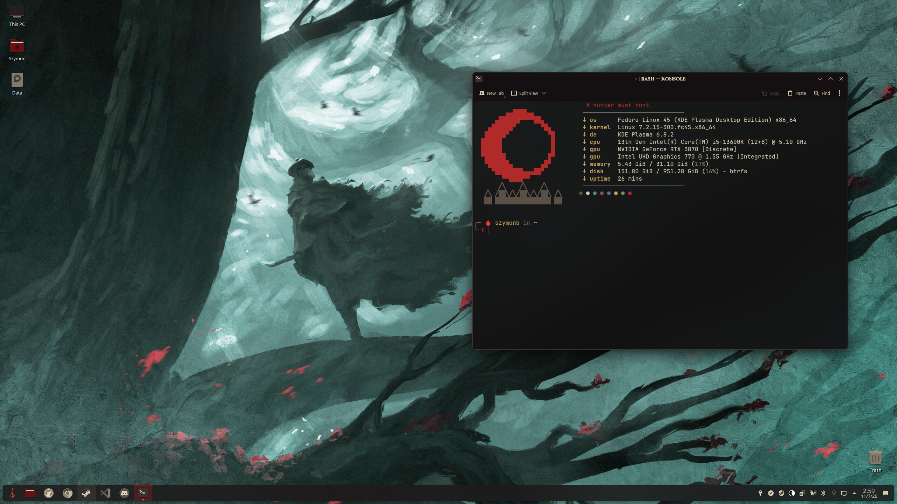
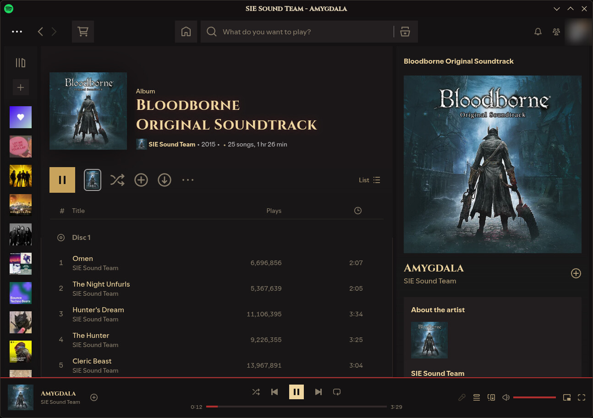
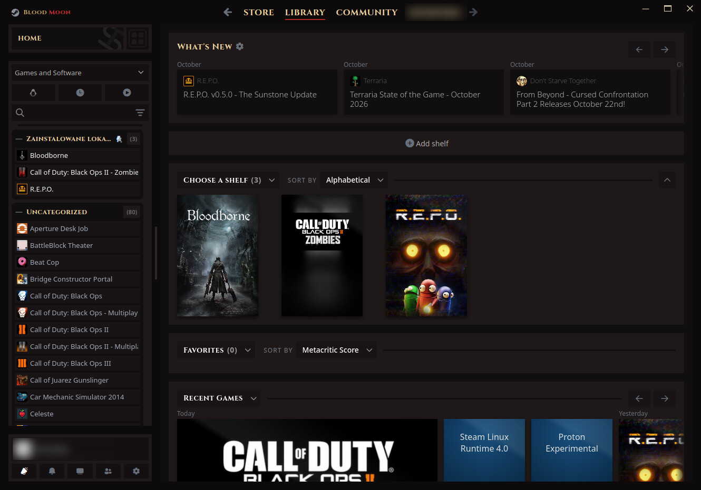

# 🩸 Blood Moon

A dark KDE Plasma 6 theme in ash, old blood and gold, inspired by Bloodborne.
It covers the desktop, the icons, VS Code, LibreWolf, Spotify and Steam, so everything matches.



<sub>Wallpaper by <a href="https://www.artstation.com/artwork/0XAwP5">Anato Finnstark</a>, not included in this repo. Support him on <a href="https://www.patreon.com/anatofinnstark">Patreon</a>.</sub>

| Spotify | Steam |
|---|---|
|  |  |

## What's inside

| Part | What you get |
|---|---|
| **KDE color scheme** | `BloodMoon.colors`: near-black windows, blood-red selection, gold accents |
| **Icons** | **Hunter**: Papirus recolored to ash and bone with blood-red accents, plus a custom bell volume icon. **Papirus-Dark-Blood**: Papirus Dark with carmine folders |
| **Window titles** | Cinzel font (SIL Open Font License) |
| **Start menu** | Hunter's Mark rune as the launcher icon |
| **VS Code** | Blood Moon color theme, plus optional settings that use the KDE title bar (Cinzel title, matching other windows) and turn off telemetry, Copilot/AI chat, the welcome page and tips |
| **Spotify** | Spicetify theme: Blood Moon colors, Cinzel titles, square corners, red progress bars. See [`spotify/`](spotify/) |
| **Steam** | Millennium theme: a Blood Moon recolor of [SpaceTheme for Steam](https://github.com/SpaceTheme/Steam) by SpaceEnergy. See [`steam/`](steam/) |
| **LibreWolf / Firefox** | `userChrome.css`: square tabs, square URL bar, Blood Moon colors. `userContent.css`: themed new tab and settings pages |

## Install

Requirements: KDE Plasma 6, plus `papirus-icon-theme` for the icons.

```bash
sudo dnf install papirus-icon-theme     # Fedora; use your distro's package manager otherwise
git clone https://github.com/szymboro/BloodMoon-theme.git
cd BloodMoon-theme
./install.sh
```

Install only some parts:

```bash
./install.sh kde icons fonts      # just the desktop
./install.sh librewolf            # just the browser
./install.sh vscode --vscode-settings   # VS Code theme + de-bloated settings
./install.sh spotify steam        # just the apps
```

Everything is installed into your home folder, so you don't need sudo. Any file the installer replaces is backed up first as `*.bak-<date>`.
Log out and back in afterwards so every app picks up the new look.

### Icons

The Hunter icons are not stored in this repo. `install.sh` builds them from your system's Papirus
with `make-hunter-icons.py`, which takes about 10 seconds. Re-run it after Papirus updates:

```bash
python3 ~/.local/share/icons/make-hunter-icons.py
```

### Spotify and Steam

Neither app supports themes on its own, so each needs a mod tool installed first:
[Spicetify](https://spicetify.app) for Spotify and [Millennium](https://steambrew.app) for Steam.
The installer skips either part if its tool is missing. Details, including the extra steps for
Flatpak Spotify and Fedora's OpenSSL, are in [`spotify/README.md`](spotify/README.md) and
[`steam/README.md`](steam/README.md).

The Steam theme is **based on [SpaceTheme for Steam](https://github.com/SpaceTheme/Steam)**.
The layout is SpaceEnergy's work; this repo only recolors it and makes a few readability fixes.

### LibreWolf / Firefox

The installer finds your default LibreWolf profile, copies the CSS into `chrome/`, and turns on
`toolkit.legacyUserProfileCustomizations.stylesheets`. For Firefox, copy `librewolf/*.css` into
`<profile>/chrome/` yourself and set that pref in `about:config`. The CSS was written against
LibreWolf 159. Firefox changes its interface often, so a future version may need tweaks.

## Palette

| | Hex | Used for |
|---|---|---|
|  | `#110e0f` | editor and page background |
|  | `#1d1819` | windows |
|  | `#821a1a` | selection |
|  | `#b02a2a` | focus and active accent |
|  | `#c9a45c` | gold: icons, links, highlights |
|  | `#d8cbb0` | text |

## Uninstall

Pick another color scheme and icon theme in System Settings. Then remove:

```bash
rm -rf ~/.local/share/icons/{Hunter,Papirus-Dark-Blood} ~/.local/share/color-schemes/BloodMoon.colors
rm -rf <librewolf-profile>/chrome
code --uninstall-extension local.bloodmoon-theme
spicetify restore                                   # Spotify
rm -rf ~/.steam/steam/millennium/themes/SpaceBloodMoon   # Steam
```

## Credits and licenses

- Theme files, scripts and the VS Code theme: MIT (see `LICENSE`)
- Icons are generated from [Papirus](https://github.com/PapirusDevelopmentTeam/papirus-icon-theme) (GPL-3.0). No Papirus files are stored in this repo.
- Steam theme based on [SpaceTheme for Steam](https://github.com/SpaceTheme/Steam) by SpaceEnergy (MIT, `steam/SpaceBloodMoon/LICENSE-SpaceTheme`), which bundles Microsoft's Fluent UI System Icons (MIT)
- Spotify theme runs on [Spicetify](https://github.com/spicetify/cli); Steam theme runs on [Millennium](https://github.com/SteamClientHomebrew/Millennium)
- [Cinzel](https://github.com/NDISCOVER/Cinzel) font: SIL Open Font License 1.1 (`fonts/OFL.txt`)
- Fan-made and inspired by *Bloodborne*. Not affiliated with FromSoftware or Sony Interactive Entertainment.
