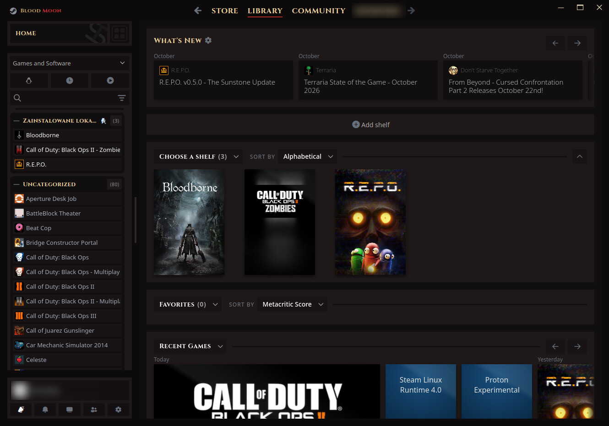

# Blood Moon for Steam

> **Based on [SpaceTheme for Steam](https://github.com/SpaceTheme/Steam) by SpaceEnergy.**
> All the layout work is theirs. This folder is a recolor of it, made from upstream commit
> [`3ca9b61`](https://github.com/SpaceTheme/Steam/commit/3ca9b6104f) (2026-11-04).
> If you like it, support the original: [Ko-fi](https://ko-fi.com/spacetheme) ·
> [SpaceTheme on GitHub](https://github.com/SpaceTheme/Steam).

Requires [Millennium](https://steambrew.app). Install it, then run `./install.sh steam` from the
repo root, restart Steam and pick **Blood Moon (SpaceTheme)** under
Steam → Settings → Millennium → Themes.

## What changed compared with SpaceTheme

| File | Change |
|---|---|
| `src/css/root.css` | Whole palette swapped to Blood Moon (near-black, blood red, gold), plus a brighter red used for text |
| `skin.json` | Name and credits; corner rounding defaults to 0 (square); new default font option; `github` field removed so Millennium won't overwrite the recolor with an upstream update |
| `options/fonts/bloodmoon.css` | New font option: Noto Sans for text, Cinzel for titles, nav and collection names |
| `src/css/steam/titlebar.css` | Logo reads "Blood Moon" in Cinzel, gold and red |
| `src/css/regular.css` | Window buttons drawn in cream so they're visible on the dark title bar |
| `src/css/steam/sidebar.css` | Selected game name in light gold so it stays readable |
| `src/css/libraryroot.custom.css` | Red scroll-to-top button, gold glow and red underline on the active tab |
| 12 other CSS files | Text that used the accent color now uses the brighter red (deep red text was unreadable) |

Every SpaceTheme option in Millennium's theme settings still works and keeps these colors.

## Notes

- Steam renames its internal class names on big client updates. If parts of Steam lose the theme,
  grab a fresh copy of SpaceTheme and re-apply the changes listed above.
- Some Millennium versions cache theme colors in `~/.config/millennium/config.json`
  (`themes.themeColors`). If a color edit doesn't show up, close Steam and delete that entry.

## License

SpaceTheme is MIT licensed, © 2023-2026 SpaceTheme. Its license is kept here as
`SpaceBloodMoon/LICENSE-SpaceTheme`. The bundled Fluent UI System Icons are MIT, © Microsoft
(`SpaceBloodMoon/LICENSE-3rdParty.md`). The Blood Moon changes are MIT like the rest of this repo.
